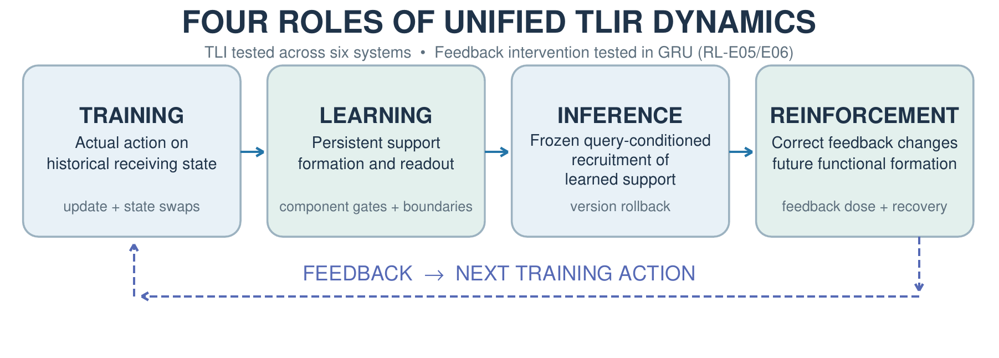
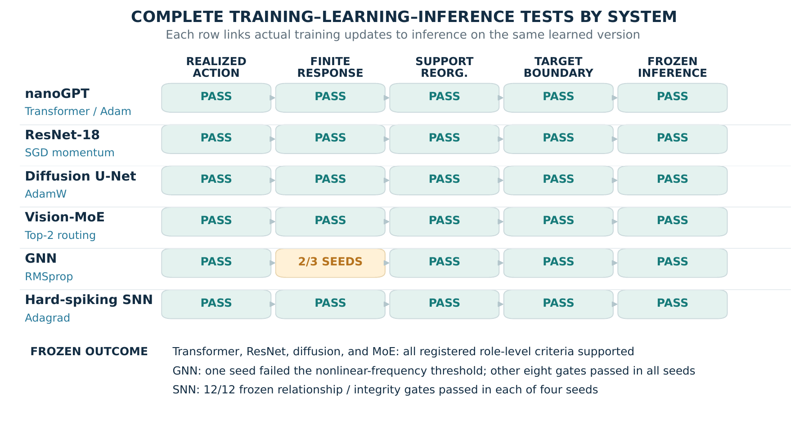

> **译稿说明**：本稿逐节翻译 **TLIR — CVPR 2027 会议版**，以 `tlir-cvpr2027-format/manuscripts/tlir_cvpr2027/main.tex` 与对应正式 PDF 为依据，而非后来改写的 Science/Gemini 版。原章节结构、科学主张、实验索引、数据、公式及研究顺序均保留。论文内图形沿用会议版原图（图内英文不另行改绘），图题与图注已翻译；参考文献书目信息按原英文保留。

# 摘要

我们研究跨神经系统的统一训练—学习—推理—强化（Training–Learning–Inference–Reinforcement，TLIR）动力学。训练表现为参数—优化器状态的演化：同一个实际发生的更新，在不同接收状态下可能产生不同的有限振幅功能响应。学习使分布式功能支撑发生持久重组；当目标的功能状态跨越其读出边界时，其能力状态随之改变。推理在持久学习状态保持冻结的条件下，调用并组合已经学得的功能支撑；强化则将环境后果与后续训练动作联系起来。我们首先在 nanoGPT 中确立相互连接的训练—学习—推理（TLI）关系，随后在 ResNet-18、扩散 U-Net、路由式 Vision-MoE、图神经网络以及硬脉冲循环网络中检验这些关系。实验包括实际更新交换、有限振幅响应路径、组件联盟干预、目标边界测量，以及对精确训练版本进行回滚的冻结推理。一个由理论导出的目标边界预测器，可跨架构分类已形成更新所引起的即时结果。在第七种系统——共享 GRU 策略——中，RL-E05/E06 研究正确反馈的集中如何改变功能支撑、削弱其他已经掌握的能力，以及重新分配反馈如何使这些能力恢复。综合结果为训练动作、学习、推理和强化提供了一个能够沿实验过程追溯的统一解释。

# 1. 引言

训练、泛化、能力形成和推理是神经网络研究的核心问题。不同领域针对这些问题发展出了具有影响力的理论。

在**优化理论**中，神经切线核（Neural Tangent Kernel，NTK）通过网络雅可比矩阵及其对应的核，描述特定训练状态下参数变化所引起的输出变化［Jacot 等，2018］。稳定性边缘（Edge of Stability）研究训练行为与 Hessian 最大特征值、学习率和损失轨迹之间的关系［Cohen 等，2021］。锐度感知最小化（Sharpness-Aware Minimization，SAM）利用参数邻域内的损失变化构造训练更新，以改善泛化能力［Foret 等，2021］。在这些理论中，**当前状态**通过参数以及参数的局部导数或曲率表示；**实际更新**由优化器产生；**响应**表现为模型输出或损失的变化。

在**表征学习与泛化**研究中，频谱偏置（Spectral Bias）考察函数或核模态在不同频率上的学习速度［Rahaman 等，2019］。隐式偏置（Implicit Bias）研究优化器为何选择特定解，例如可分数据上的最大间隔方向［Soudry 等，2018］。神经坍缩（Neural Collapse）测量类别特征均值、类内差异和分类器几何结构，揭示训练准确率饱和后仍在持续发生的表征变化［Papyan 等，2020］。信息瓶颈理论研究输入、隐藏表征与目标之间的互信息，包括与任务有关的信息如何保留及压缩［Tishby 和 Zaslavsky，2015］。这些研究中的**内部组织**可以表现为频谱模态、优化器选择的解、特征几何或信息结构；**功能变化**则体现为学习速度、解的演化和预测表现。

在**能力形成**研究中，Grokking 描述模型拟合训练样本与获得较强测试泛化能力之间存在较长延迟的现象［Power 等，2022］。随后的电路研究追踪这一延迟期间内部计算结构的形成与重组［Nanda 等，2023］。双重下降（Double Descent）研究测试误差如何在插值区域附近上升，然后随着模型规模、训练时间或数据条件变化再次下降［Belkin 等，2019；Nakkiran 等，2020］。这些研究通过训练阶段或插值状态衡量**当前状态**，通过电路与解的演化衡量**内部变化**，通过准确率和泛化误差衡量**可观察能力**。

在**持续学习**中，新任务的训练降低模型在旧任务上的表现时，就会发生灾难性遗忘。弹性权重巩固（Elastic Weight Consolidation，EWC）使用旧任务的 Fisher 信息估计参数重要性，并惩罚重要参数的变化［Kirkpatrick 等，2017］。梯度情景记忆（Gradient Episodic Memory，GEM）利用新任务梯度与旧任务梯度之间的内积约束新更新［Lopez-Paz 和 Ranzato，2017］。正交梯度下降（Orthogonal Gradient Descent，OGD）把新梯度投影到近似保留旧任务输出的方向上［Farajtabar 等，2020］。在这些方法中，**已有状态**包括先前学得的参数和对函数敏感的方向；**更新**是受约束的新任务动作；**相互作用**通过重叠的梯度或功能子空间发生；**能力变化**以保持、遗忘或迁移来衡量。

在**推理研究**中，注意力机制通过查询、键和值计算依赖输入的信息权重［Vaswani 等，2017］。上下文学习研究在模型参数不变的情况下，提供在上下文中的示例与任务信息如何影响预测［Brown 等，2020］。思维链提示研究中间推理步骤对复杂任务表现的影响［Wei 等，2022］。**当前状态**是已经训练的模型；**输入条件**包括查询、上下文和中间计算；**内部计算**随注意力和激活状态变化；**功能表现**由产生的预测来观察。

在**强化与反馈驱动训练**中，基于人类反馈的强化学习（RLHF）利用偏好与奖励信号调整模型行为［Ouyang 等，2022］。自训练利用模型自身预测生成进一步的训练数据［Xie 等，2020］。递归模型坍缩研究考察连续多代模型使用前代生成的数据训练时，低概率模式如何丢失［Shumailov 等，2024］。这里，**反馈**通过奖励、偏好或生成数据分布提供；**训练动作**是由此产生的更新；随后的**功能变化**通过行为、准确率及生成分布观察。

这些研究使用不同的数学对象——核、Hessian 矩阵、梯度、类别特征、互信息、任务分数、注意力权重与奖励信号——但仍可辨认出六类反复出现的要素：**当前状态、实际更新、功能响应、内部组织、可观察能力和反馈**。TLI 核心关系是在开展这种跨领域比较之前通过实验确立的；此处识别反复出现的变量，是为了帮助读者理解理论，而不是描述理论最初的发现过程。

{width=95%}

**图 1｜TLIR 的四个平级角色。** TLI 核心在六种神经系统中接受检验；RL-E05/E06 则通过共享 GRU 策略中的受控反馈重分配来检验强化过程。

# 2. 实验系统与方法

## 2.1 神经系统与索引化实验

TLI 核心关系首先通过 nanoGPT 中的 TL-E01～E08 和 INF-E01 确立，其中 TL-P01 检验一个预测性推论。随后，另外五种系统重新检验其相互连接的角色。RL-E05/E06 在第七种系统——共享 GRU 策略——中研究正确反馈如何重新分配已经学得的功能支撑，并改变已有能力的保持情况。表 1 列出已执行实验的系统和预先注册的功能组件组。

**表 1｜七种神经系统：六条 TLI 实验链和一组 GRU 反馈研究。**

| 系统（优化器） | 任务／注册的功能组件 |
|:--|:--|
| nanoGPT（Adam） | 循环式下一词元预测；4 个注意力/MLP 分支 |
| ResNet-18（SGD Momentum） | CIFAR-100 分类；4 个残差阶段 |
| Diffusion U-Net（AdamW） | CIFAR-10 去噪；4 个 U-Net 路径 |
| Vision-MoE（AdamW） | CIFAR-100 分类；4 个路由专家 |
| GNN（RMSprop） | 图可达性；4 个消息传递块 |
| 脉冲 SNN（Adagrad） | 8×8 数字识别；4 个脉冲块 |
| GRU（RL-E05/E06；AdamW） | 四能力反馈；4 个共享隐藏状态组 |

## 2.2 训练：实际动作与接收状态

在一个已注册的更新时刻，实际模型—优化器状态为 $Z_t=(\theta_t,\omega_t)$，其中真实发生的参数动作为 $\Delta\theta_t=\theta_{t+1}-\theta_t$。实验记录更新前状态、小批量数据、梯度、优化器记忆和原生更新后状态。TL-E01/E02 考察能力轨迹，以及优化器暂停／梯度裁剪对照。TL-E03 将**完全相同的已形成更新**移植到不同历史接收状态，并分别以对应的不更新分支为基线比较响应：

$$
R_q(\theta_A,\Delta\theta_B)\quad\text{与}\quad R_q(\theta_B,\Delta\theta_B). \tag{1}
$$

对于目标 $q$，这里的 $R_q(\theta,\Delta)=m_q(\theta+\Delta)-m_q(\theta)$。另一个优化器记忆分叉实验保持当前参数和梯度固定，同时替换历史优化器记忆：

$$
\Delta^{(a,b)}=\operatorname{OptStep}(\theta_t,g_t,\omega_{a,b}). \tag{2}
$$

TL-E04 在不同有限振幅下评估**实际发生的更新**：

$$
r_{t,q}(\alpha)=m_q(\theta_t+\alpha\Delta\theta_t)-m_q(\theta_t), \tag{3}
$$

跨系统共同采用的振幅网格为 $\alpha\in\{0,0.125,0.25,0.5,0.75,1\}$。响应路径呈现线性、饱和、加速、回折和符号反转等状态。TL-E05 识别出响应发生前的三类主要条件因素：当前目标边界状态（F1）、目标特定的更新几何（F3），以及参数—优化器接收状态（F5）。

## 2.3 学习：功能支撑形成与读出

TL-E06 对已识别的组件施加可逆零值门控。对于活跃组件联盟 $C\subseteq\mathcal C$，令 $v_{t,q}(C)=m_q(f_{\theta_t}^{(C)}(x_q))$。单组件和双组件干预测量必要性、备份、替代、相互作用和失效余量；跨系统实现还检验四个组件的全部 16 种联盟及其精确 Shapley 效应：

$$
\phi_{j,q}=\sum_{C\subseteq\mathcal C\setminus\{j\}}\frac{|C|!(3-|C|)!}{4!}\left[v_q(C\cup\{j\})-v_q(C)\right]. \tag{4}
$$

TL-E07 比较**同一次更新**前后由干预推导出的功能支撑分配：

$$
\Delta P_{t,q}=P_q(\theta_t+\Delta\theta_t)-P_q(\theta_t), \tag{5}
$$

其中包括支撑交接以及组件相互作用。TL-E08 对齐目标身份与目标读出边界。分类器使用 $m_q=\ell_y-\max_{c\ne y}\ell_c$；扩散模型使用原生残差竞争边界 $m_q=\min_k(E_k-E_{\mathrm{true}})$。更新前后的符号得到四种结果：$(1,1)$、$(1,0)$、$(0,0)$ 和 $(0,1)$，分别对应能力维持、丧失、尚未获得及恢复／获得。

## 2.4 推理：冻结调用与回滚

INF-E01 检验 13 条 nanoGPT 训练历史及 52 个已识别检查点；INF-G01/G02 与 GNN/SNN 实验进一步扩展这些测量。在固定的已学习状态 $L^*$ 下，推理按照查询条件调用功能支撑，并在当前一次计算中将其组合：

$$
S_{q,c}^{\mathrm{active}}=\Pi_{q,c}(L^*),\qquad y_{q,c}=H_{q,c}(S_{q,c}^{\mathrm{active}}). \tag{6}
$$

冻结组件门控在**完整输出**层面测量非加性：

$$
I_{ij,q}=f_{\mathrm{full}}-f_{-i}-f_{-j}+f_{-i,-j}. \tag{7}
$$

随后，将每个训练完成的组件单独替换为其精确的学习前版本，其他训练后的参数保持固定；由此产生的输出效应为：

$$
D_{j,q}=f(q;\theta^*)-f(q;\theta^{(j\leftarrow\mathrm{pre})}). \tag{8}
$$

最后恢复该组件原来的训练后版本，并检查输出与持久模型／优化器状态是否精确恢复。

## 2.5 强化：正确反馈的重新分配

强化是 TLIR 中与其他角色平级的一部分，而不是附加在 TLI 上的内容。RL-E05 和 RL-E06 从一个不使用注意力机制的共享 GRU 策略出发，此时**四项能力都已达到掌握水平**。各实验分支拥有相匹配的初始参数—AdamW 状态。只有完整的两次决策链正确时才获得 $r=1$，否则为 $r=0$。干预改变的是**正确反馈集中在哪些能力上**，而不是奖励规则。

RL-E05 比较仅向一项已掌握能力提供选择性反馈、向四项能力提供均衡反馈，以及只有接触而不执行参数更新的冻结条件。利用四组 GRU 组件的全部 16 种联盟测量 Shapley 支撑和任务间隔；并通过 15 种非空组件版本回滚组合检验观察到的能力权衡。

RL-E06 在改变反馈分配的同时，将每次更新的 60 个 episode 和总共 3,200 次更新的预算保持不变（表 2）。在独占反馈第 800 次更新时，从完全相同的状态分出两个恢复分支，各继续训练 2,400 次更新：重新均衡分配 $[15,15,15,15]$，或仅训练其他能力 $[0,20,20,20]$。在同一已学习策略上测量反馈剂量、支撑份额、连续目标间隔、正确性和恢复。该实验将内部间隔侵蚀与随后发生的二值能力丧失区分开，并检验改变反馈分配是否会逆转两者。

**表 2｜RL-E06 每次更新分配给各能力的反馈 episode 数。**

| 反馈条件 | $q_0$ | $q_1$ | $q_2$ | $q_3$ |
|:--|--:|--:|--:|--:|
| 均衡（Balanced） | 15 | 15 | 15 | 15 |
| 轻度集中（Mild） | 30 | 10 | 10 | 10 |
| 高度集中（High） | 45 | 5 | 5 | 5 |
| 独占（Exclusive） | 60 | 0 | 0 | 0 |

## 2.6 预测与索引化证据

TL-P01 在**实际更新形成之后**、但尚未读取更新后目标响应之前，预测即时目标边界。对于目标 $y$、竞争类别 $c$ 和隐藏输出 $h$，定义 $b_c=w_y-w_c$、$\Delta b_c=\Delta w_y-\Delta w_c$。冻结的 `quadratic_complete` 算法使用更新前沿实际更新方向的一阶及二阶导数 $h'=Dh[\Delta\theta_t]$ 与 $h''=D^2h[\Delta\theta_t,\Delta\theta_t]$：

$$
\begin{aligned}
\widehat g_{y,c}={}&b_c^\top h+\Delta b_c^\top h+b_c^\top h'\\
&+\Delta b_c^\top h'+\tfrac12 b_c^\top h''.
\end{aligned} \tag{9}
$$

当且仅当 $\min_{c\ne y}\widehat g_{y,c}>0$ 时，才预测该目标正确；结合初始正确性与预测正确性即可得到四种目标状态转移。预测在更新后结果裁决之前被封存。跨系统预测器根据各自的原生任务调整方向响应计算。

**表 3｜索引化实验链及其检验的关系。**

| 实验索引 | 实验／因果角色 |
|:--|:--|
| TL-E01～E05 | 状态演化、接收状态分叉、有限振幅路径、响应坐标 |
| TL-E06～E08 | 组件支撑、支撑重分配、能力读出 |
| TL-P01 | 更新后目标边界预测 |
| INF-E01 | 已学习版本的冻结推理 |
| TL-G01～G03 | ResNet、扩散模型及 MoE：训练—学习 |
| INF-G01～G02 | ResNet、扩散模型及 MoE：冻结推理 |
| GNN／SNN | 额外的系统内 TLI 检验 |
| RL-E05／E06 | 选择性反馈、干扰、剂量与恢复 |

这些记录保留了具体目标、更新和参数版本的身份、预先声明的检验，以及全部观察结果；独立检查程序或原生重新执行被用于核验所报告的结果。

{width=95%}

**图 2｜系统内部的训练—学习—推理实验链。** 一个 GNN 随机种子满足九项注册门槛中的八项，其非线性响应出现率低于预设阈值；SNN 在四个种子中均通过十二项注册门槛。

# 3. 结果：跨系统 TLI 与强化

## 3.1 Transformer、ResNet、扩散模型与 MoE 的原生实验链

最初的 nanoGPT 实验使用实际更新干预、分布式支撑测量、身份对齐的目标状态转移，以及基于精确历史训练版本的冻结推理。冻结推理部分检查了 13 条经过验证的训练历史和 52 个选定检查点。更新后目标边界预测器在 5,088 个确认集目标中正确裁决了 4,652 个（准确率为 91.43%，四类状态转移宏平均召回率为 91.49%），并保留了预测错误记录。

在 ResNet 中，全部 42/42 次已注册的参数接收状态交换均超过冻结的响应差异阈值；1,536 条目标—更新响应路径中有 32.23% 符合非线性判据，91.41% 的支撑记录超过指定的重分配阈值。随后，这些训练检查点进入冻结推理协议；三个随机种子全部通过，包括已学习版本回滚和精确恢复。

在扩散 U-Net 中，全部 18/18 次参数状态交换超过阈值。在 504 条记录中，19.25% 出现非线性有限振幅响应，97.02% 的支撑重分配超过阈值。对应的冻结推理协议在三个随机种子上全部通过，包括对 $\epsilon$ 预测器的干预效应和完整的 100 步确定性采样。这是一个以残差误差为能力边界的生成任务，而不是另一个按类别标签进行判断的分类器。

Vision-MoE 在具有路由机制的专家组织中重复了这一相互连接的实验。全部 36/36 次参数状态交换和 18/18 次 Adam 记忆交换均超过其预注册阈值；1,344 条目标—更新记录中，35.71% 出现非线性路径，80.43% 的专家支撑重分配超过阈值。随后，在相同的最终已学习版本上检验确定性 top-2 路由、查询特定的专家调用、非加性联盟、训练完成的专家／路由器回滚与恢复。三个种子的联合冻结裁决为 `MOE_UNIFIED_DYNAMICS_SUPPORTED`。

因此，这四种系统在实际动作、有限振幅响应、支撑、边界以及冻结推理等角色之间提供了**重复出现的系统内证据**。特别是，推理证据通过精确的参数版本身份与训练过程相连接，而不仅是另一个模型表现出相似行为。

## 3.2 GNN 与硬脉冲 SNN 压力测试

GNN 实验执行相同的实验序列：实际更新／接收状态检验、有限振幅路径、更新前后组件联盟支撑、目标边界，以及精确已学习版本的冻结推理。全部三个正式种子都形成了预期能力，并通过八项冻结判据。其中两个种子通过第九项——非线性响应出现率 $\geq10\%$ 的判据；另一个种子仅有 4/256 条路径符合条件（1.56%），因此该项判定**失败**。三个种子的状态—响应、支撑、能力及冻结推理测量均已完成。

硬脉冲 SNN 使用四个循环脉冲组件和六个时间步。在四个正式种子中，全部十二项冻结判据均通过，包括原生 Adagrad 记忆干预、有限振幅响应路径、组件支撑重组、查询条件化的推理以及精确版本回滚。该模型不连续的硬阈值前向过程尤其具有研究意义：即使基于局部导数的预测器难以描述某些阈值跨越，这些相互连接的功能角色仍然可以被观测到。

## 3.3 强化：反馈驱动的功能支撑与能力变化

RL-E05/E06 使用一个共享四能力 GRU 策略，研究 TLIR 中与其他三者同等重要的第四个角色。所有四项能力都在匹配反馈分支开始**之前**达到掌握水平；所有正奖励均由精确的两动作任务规则产生。因此，干预改变的是**正确反馈的分配方式**，而不是奖励是否有效。RL-E05 确立了选择性反馈导致的支撑集中、跨能力干扰及版本敏感的能力权衡，尽管其中更严格的已注册“大幅度事件发生时序”判据没有达到。

在 RL-E06 中，12 个正式种子都表现出严格的剂量有序变化：从均衡、轻度集中、高度集中到独占反馈，被强化能力的平均相对支撑份额分别为 **25.54%、26.47%、27.50% 和 35.20%**；与此同时，其他能力的平均间隔分别下降为 **9.474、9.130、8.493 和 3.962**。在轻度和高度集中条件下，其他能力仍保持 100% 的准确率，尽管其间隔已经受到侵蚀。与均衡反馈相比，独占正确反馈使支撑份额增加 **9.67 个百分点**，使其他能力的准确率降低 **39.06 个百分点**。从**完全相同**的独占反馈第 800 次更新状态出发，重新均衡反馈将其他能力的准确率从 **70.31% 恢复至 99.48%**，同时被强化能力仍保持 100%。因此，实验将反馈分配与持久支撑重组、连续边界侵蚀、可观察的能力丧失以及可逆恢复联系起来。

## 3.4 边界预测同时检验算法的优势和局限

直接终点预测用于测量数学近似的准确程度，并与因果干预实验相对照。表 4 比较已记录的实验。用于 nanoGPT 的主要 `quadratic_complete` 方法，根据随后各个系统的输出和激活结构进行了适配。

**表 4｜更新后目标边界分类结果。** 四类宏平均召回率是对四种实际状态转移类别分别计算召回率后取平均；仅有较高准确率还不够。不同系统的预测器实现细节与评价数据集存在差异。

| 系统 | 准确率（%） | 四类宏召回率（%） |
|:--|--:|--:|
| nanoGPT | 91.43 | 91.49 |
| ResNet-18 | 99.28 | 97.99 |
| Diffusion U-Net | 99.60 | 97.98 |
| Vision-MoE | 99.63 | 96.95 |
| GNN¹ | 98.54 | 98.62 |
| 硬脉冲 SNN¹ | 95.31 | 70.74 |

¹ 独立预测测试使用已注册的 GNN／SNN 训练历史。

对 MoE 的直接二阶终点预测器来说，两类发生能力变化的样本各只有九个，因此需要结合这一较小分母来理解其较高召回率。在 SNN 上，假定目标边界不变化的基线已经达到 93.63% 的准确率，而局部公式的总体准确率为 95.31%，但四类宏平均召回率只有 70.74%。其硬阈值使真实局部隐藏状态导数无法反映某些有限幅度的阈值跨越。因此，较低的宏召回率定位了硬激活阈值处的一个预测困难，同时实验中的功能关系仍然可以观测到。

# 4. 讨论

TLIR 是完整的理论解释体系，其中训练、学习、推理和强化是**四个平级角色**。TLI 关系在六种结构不同的系统中反复出现；精确训练历史将实际更新、状态依赖的响应、持久功能支撑重组、能力读出和已学习版本的冻结推理联系起来。第七种系统是一个共享 GRU 策略，用以检验强化如何改变**已经形成**的能力在后续训练中的发展。这一组合同时检验了功能支撑的形成与调用，以及随后将其重新组织的反馈过程。

GRU 的结果揭示了强化为何能够通过**同一种功能机制**既产生有利作用也产生不利作用：反复出现的正确反馈优先把功能支撑重新分配给获得奖励的能力，而没有得到强化的目标失去连续读出间隔，并可能随后跨过边界进入失败状态。从相同的已学习状态出发重新均衡反馈，能够在很大程度上逆转这一过程。因此，奖励的正确性本身并不能决定先前获得的全部能力能否保持。此处的证据涉及可控的功能支撑重组，而不是某种守恒的支撑总量。

定量响应模式仍随系统而异：非线性响应出现率不同，一个 GNN 种子没有达到其注册的频率门槛，硬脉冲阈值则对基于局部导数的预测提出了挑战。TLI 因果检验与 GRU 反馈干预检验 TLIR 动力学中相互补充的部分；不能将各自的实证范围误解为每一种系统都必须重复每一项干预。组件级测量也与机制的因果抽象分析相联系［Geiger 等，2025］。

# 5. 对正面与负面研究结果的统一解释

**问题与发现顺序。** 另一项针对历史研究中 **21 组正面／负面结果对**的比较，探讨共同的**接收状态—动作—响应—支撑—边界—反馈关系**，是否能同时解释局部理论取得成功的条件，以及限制这些理论适用范围的研究发现。下面的例子展示这种共同解释。

**核动力学与特征学习。** 在相应的无限宽度惰性训练状态下，NTK 动力学提供严格的局部训练描述［Jacot 等，2018］；而特征学习参数化可以产生不同的极限行为［Yang 和 Hu，2021］。TLI 将两者定位于接收状态与参数化方式不同的动作—响应状态中：冻结核投影有效，并不意味着所有有限振幅训练轨迹都保持其特征不变。两类结果处于不同的训练状态。

**尖锐极小值与有效的锐度感知训练。** 保持函数不变的重新参数化可以改变原始参数锐度，却不改变泛化表现［Dinh 等，2017］。然而，SAM 可以通过优化邻域鲁棒的损失，在特定任务中改善表现［Foret 等，2021］。这组结果的共同解释在于：原始参数几何并非完整的已学习功能状态，而锐度感知干预仍然可以有益地改变**实际训练动作**。因此，一个不具有参数化不变性的解释标量，可以与一种有效的局部控制方法同时存在。

**压缩是一种有用机制，而非普遍必要条件。** 在部分架构和测量条件下，关于普遍压缩阶段的主张不能成立［Saxe 等，2018］；与此同时，适当控制信息瓶颈可以得到有效的泛化保证［Kawaguchi 等，2023］。TLI 中的持久功能重组不要求 $I(X;T)$ 单调下降，但压缩可以是在接收状态、噪声和优化目标等具体条件下出现的一种结果。由此预测：**压缩的有效性有其条件范围，而它并非普遍必要。**

**延迟涌现与掌握能力之后的持续学习。** 在 Grokking 中，即使训练表现已经饱和，测试能力仍可能突然出现，而内部计算结构在这一过程中经历可以识别的阶段性演化［Nanda 等，2023］。神经坍缩研究同样记录到训练误差消失之后特征几何仍然持续变化［Papyan 等，2020］。TLI 将持久的功能支撑形成与离散的目标读出边界区分开来。因此，内部支撑持续形成与外部可观察状态突然转变，是同一测量区分下可以共存的结果。

**遗忘、能力保持与恢复。** 持续学习可能破坏旧能力，而 EWC 等方法能够保护某些重要性较高的参数方向［Kirkpatrick 等，2017］。在 TLI 中，旧目标的有符号响应取决于新动作与旧目标功能敏感支撑之间的重叠关系，以及目标边界尚余的安全余量。GRU 反馈分叉提供了匹配干预的例子：集中的**正确**反馈侵蚀了其他已掌握的能力，而重新均衡的反馈则在很大程度上使其恢复。

**有益的自训练与递归坍缩。** 在适当的数据混合条件下，基于伪标签的自训练能够提高准确率［Xie 等，2020］；而反复用模型生成样本替代真实数据，可能使少数模式的尾部分布逐渐丢失［Shumailov 等，2024］；在研究过的特定条件下，持续积累真实数据可以防止这种退化［Gerstgrasser 等，2024］。二者遵循反馈与数据之间的不同关系：推理生成的样本本身既不是天然有益的，也不是天然有害的；重要的是它保留了哪些信息，以及后续引发怎样的训练动作。对于保留率为 $0<\rho<1$ 的某个保留不足模式，一个有条件的示意性递推为：

$$
q_{t+1}=(1-\alpha)\rho q_t+\alpha q_{\mathrm{real}}. \tag{10}
$$

当 $\alpha=0$ 时，该模式发生收缩；当 $\alpha>0$ 且 $q_{\mathrm{real}}>0$ 时，真实数据输入提供一个正的固定点下限。这一递推描述的是某种数据模式在连续生成中反复保留不足的情况。

**理论先行的外推。** 除了历史研究之间的比较，TLIR 关系还被用于在检索相关文献**之前**，推导条件性预测及其检验条件。例如，指数尾损失下能力形成后的最大间隔选择［Soudry 等，2018］，以及不断演化的状态在稳定性边缘处的稳定性［Cohen 等，2021］。这些比较识别了局部数学结果出现所需的特定状态、动作和边界条件。未来的实验可以直接干预这些条件，并检验相应的预测转变。

# 6. 结论

我们研究神经系统统一的训练—学习—推理—强化（TLIR）动力学。六种不同架构反复呈现一组相互连接的 TLI 关系：**实际动作、接收状态响应、持久支撑重组、能力边界以及精确版本的冻结推理**。在第七种基于 GRU 的系统中，RL-E05/E06 表明，**正确**反馈可以选择性地集中功能支撑、削弱其他已经掌握的能力；当反馈被重新分配时，这些变化能够得到逆转。预测性边界算法，以及对先前分开研究的正面和负面结果所作的统一解释，均来自这一建立在实验基础上的 TLIR 理论框架。

# 大语言模型使用声明（LLM Usage Statement）

OpenAI ChatGPT 被用于研究构思与讨论、协助实验协议设计与代码开发／审查、解释实验记录，以及论文起草、编辑和 LaTeX 排版。作者对研究设计、全部科学主张和所报告的结果负责。

# 参考文献

以下按会议版参考文献原有的英文著录保留，不另行改变文献信息。

1. M. Belkin, D. Hsu, S. Ma, and S. Mandal. Reconciling modern machine-learning practice and the classical bias–variance trade-off. *PNAS*, 116 (32): 15849–15854, 2019.

2. T. B. Brown et al. Language models are few-shot learners. *Advances in Neural Information Processing Systems*, 2020.

3. J. M. Cohen et al. Gradient descent on neural networks typically occurs at the edge of stability. *Proc. ICLR*, 2021.

4. L. Dinh, R. Pascanu, S. Bengio, and Y. Bengio. Sharp minima can generalize for deep nets. *Proc. ICML*, pages 1019–1028, 2017.

5. M. Farajtabar, N. Azizan, A. Mott, and A. Li. Orthogonal gradient descent for continual learning. *Proc. AISTATS*, pages 3762–3773, 2020.

6. P. Foret, A. Kleiner, H. Mobahi, and B. Neyshabur. Sharpness-aware minimization for efficiently improving generalization. *Proc. ICLR*, 2021.

7. A. Geiger et al. Causal abstraction: A theoretical foundation for mechanistic interpretability. *J. Mach. Learn. Res.*, 26 (83): 1–64, 2025.

8. M. Gerstgrasser et al. Is model collapse inevitable? breaking the curse of recursion by accumulating real and synthetic data. *ICML Workshop on Foundation Models in the Wild*, 2024.

9. A. Jacot, F. Gabriel, and C. Hongler. Neural tangent kernel: Convergence and generalization in neural networks. *Advances in Neural Information Processing Systems*, 2018.

10. K. Kawaguchi et al. How does information bottleneck help deep learning? *Proc. ICML*, 2023.

11. J. Kirkpatrick et al. Overcoming catastrophic forgetting in neural networks. *PNAS*, 114 (13): 3521–3526, 2017.

12. D. Lopez-Paz and M. A. Ranzato. Gradient episodic memory for continual learning. *Advances in Neural Information Processing Systems*, pages 6467–6476, 2017.

13. P. Nakkiran et al. Deep double descent: Where bigger models and more data hurt. *Proc. ICLR*, 2020.

14. N. Nanda, L. Chan, T. Lieberum, J. Smith, and J. Steinhardt. Progress measures for grokking via mechanistic interpretability. *International Conference on Learning Representations*, 2023.

15. L. Ouyang et al. Training language models to follow instructions with human feedback. *Advances in Neural Information Processing Systems*, 2022.

16. V. Papyan, X. Y. Han, and D. L. Donoho. Prevalence of neural collapse during the terminal phase of deep learning training. *PNAS*, 117 (40): 24652–24663, 2020.

17. A. Power, Y. Burda, H. Edwards, I. Babuschkin, and V. Misra. Grokking: Generalization beyond overfitting on small algorithmic datasets, 2022. arXiv:2201.02177, 2022.

18. N. Rahaman et al. On the spectral bias of neural networks. *Proc. ICML*, pages 5301–5310, 2019.

19. A. M. Saxe et al. On the information bottleneck theory of deep learning. *Proc. ICLR*, 2018.

20. I. Shumailov et al. Ai models collapse when trained on recursively generated data. *Nature*, 631: 755–759, 2024.

21. D. Soudry et al. The implicit bias of gradient descent on separable data. *J. Mach. Learn. Res.*, 19 (70): 1–57, 2018.

22. N. Tishby and N. Zaslavsky. Deep learning and the information bottleneck principle, 2015. in IEEE Information Theory Workshop, 2015, arXiv:1503.02406.

23. A. Vaswani et al. Attention is all you need. *Advances in Neural Information Processing Systems*, pages 5998–6008, 2017.

24. J. Wei et al. Chain-of-thought prompting elicits reasoning in large language models. *Advances in Neural Information Processing Systems*, 2022.

25. Q. Xie, M.-T. Luong, E. Hovy, and Q. V. Le. Self-training with noisy student improves imagenet classification. *Proc. CVPR*, pages 10687–10698, 2020.

26. G. Yang and E. J. Hu. Tensor programs iv: Feature learning in infinite-width neural networks. *Proc. ICML*, pages 11727–11737, 2021.
